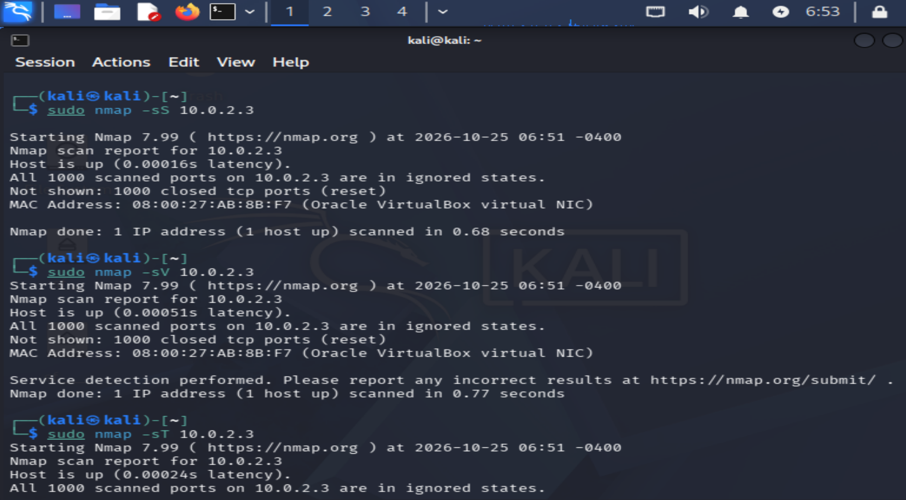
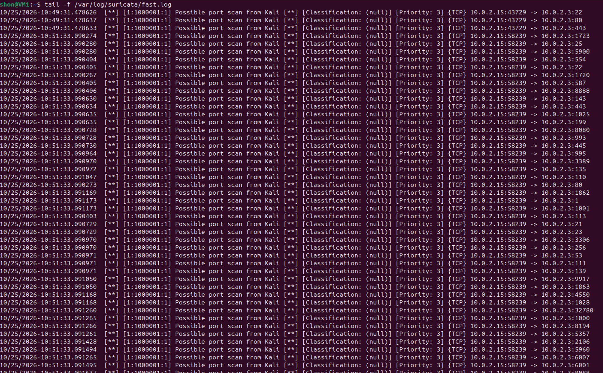
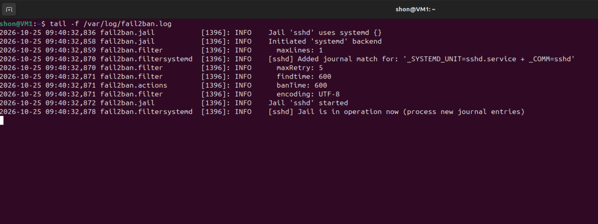
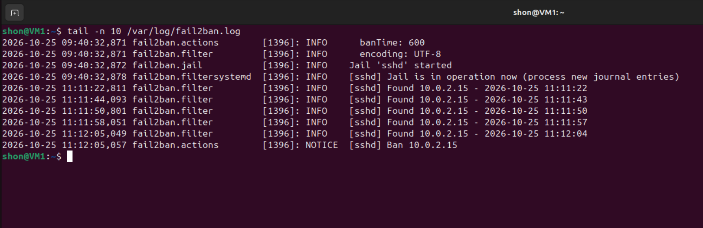
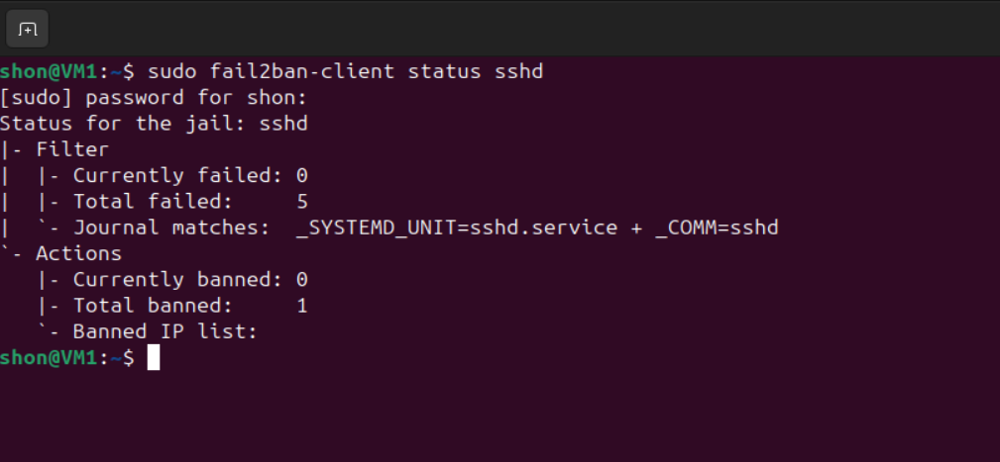
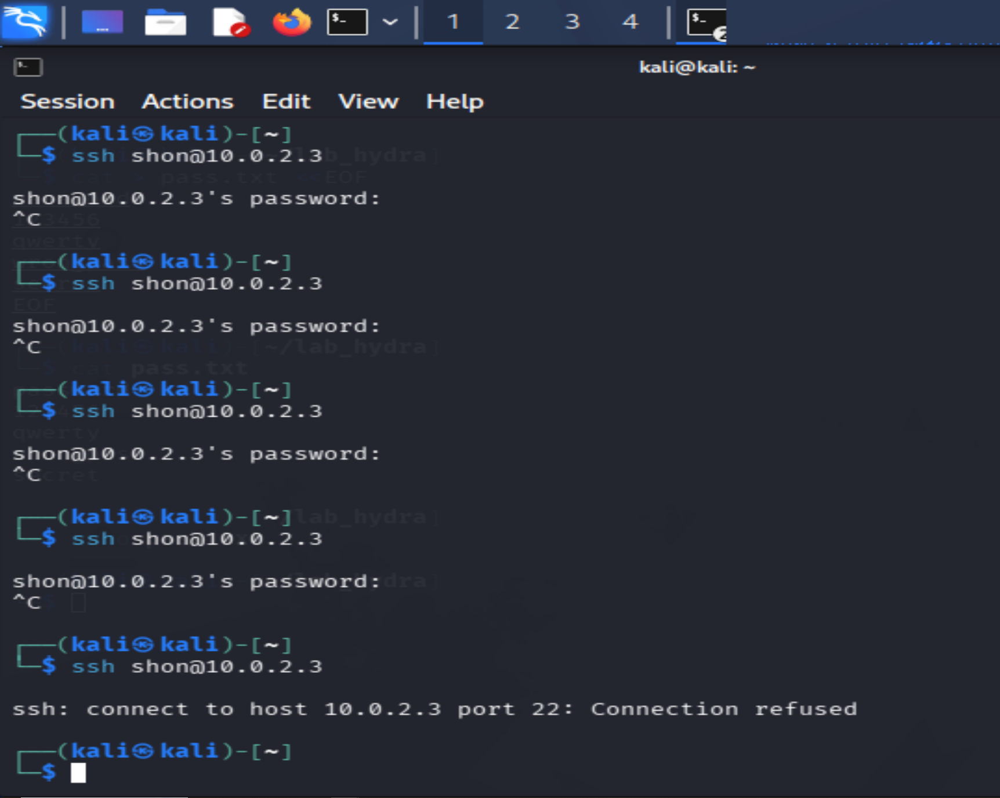
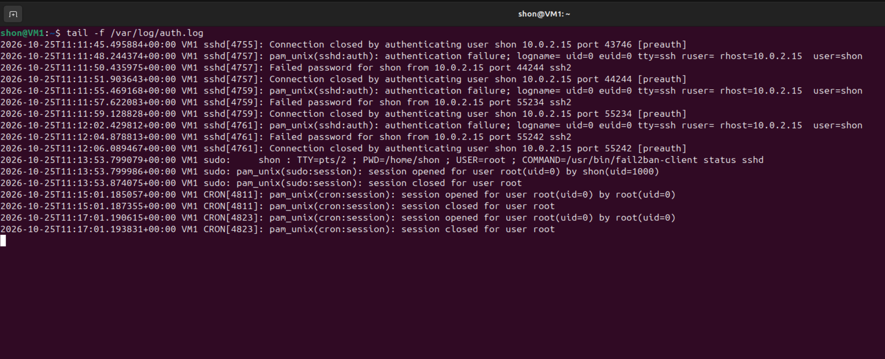
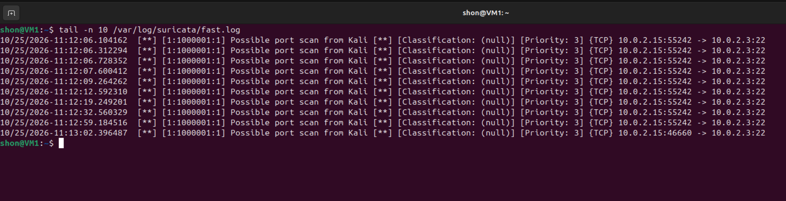

# Домашнее задание к занятию "`Защита сети`" - Шаблевский О.Н.

### Задание 1

Проведите разведку системы и определите, какие сетевые службы запущены на защищаемой системе:

sudo nmap -sA < ip-адрес >

sudo nmap -sT < ip-адрес >

sudo nmap -sS < ip-адрес >

sudo nmap -sV < ip-адрес >

По желанию можете поэкспериментировать с опциями: https://nmap.org/man/ru/man-briefoptions.html.

В качестве ответа пришлите события, которые попали в логи Suricata и Fail2Ban, прокомментируйте результат.
### Ответ:
Suricata корректно детектирует признаки сканирования и формирует алерты.

Fail2Ban не обнаружил не одного сканирования, так как при сканировании не выполнялся процесс аутентификации.

---

### Задание 2

Проведите атаку на подбор пароля для службы SSH:

hydra -L users.txt -P pass.txt < ip-адрес > ssh

Настройка hydra:
создайте два файла: users.txt и pass.txt;
в каждой строчке первого файла должны быть имена пользователей, второго — пароли. В нашем случае это могут быть случайные строки, но ради эксперимента можете добавить имя и пароль существующего пользователя.
Дополнительная информация по hydra: https://kali.tools/?p=1847.

Включение защиты SSH для Fail2Ban:
открыть файл /etc/fail2ban/jail.conf,
найти секцию ssh,
установить enabled в true.
Дополнительная информация по Fail2Ban:https://putty.org.ru/articles/fail2ban-ssh.html.

### Ответ:
Fail2Ban корректно детектирует серию неудачных попыток и блокирует источник атаки при достижении порога maxretry = 5. Suricata параллельно фиксирует сетевой трафик как возможный скан портов. Разграничение функций средств защиты подтверждено. 

---
